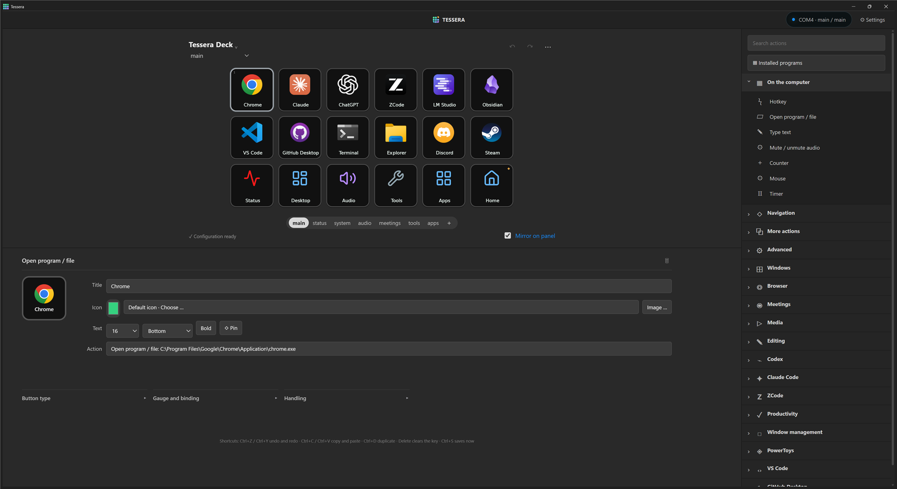
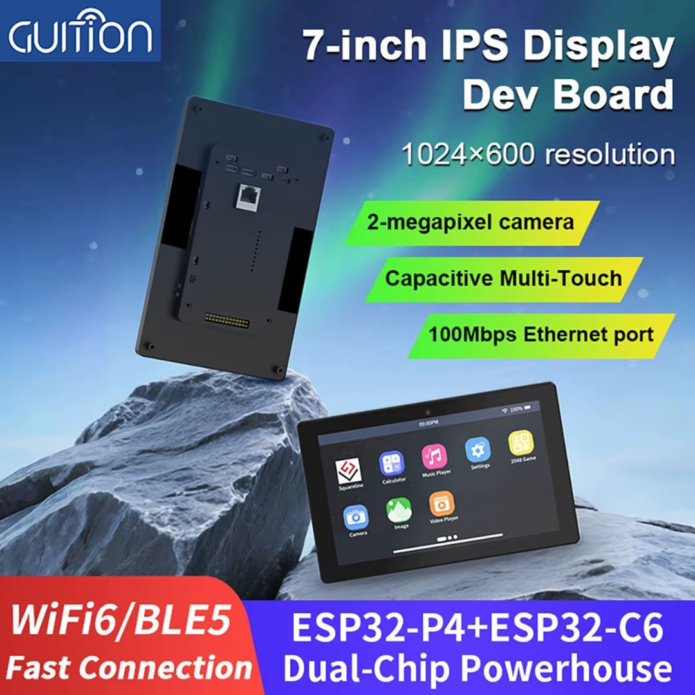
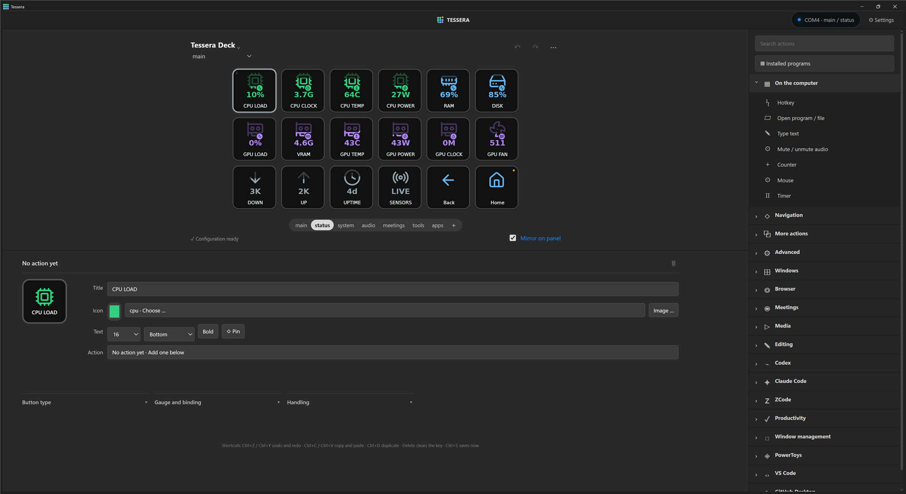
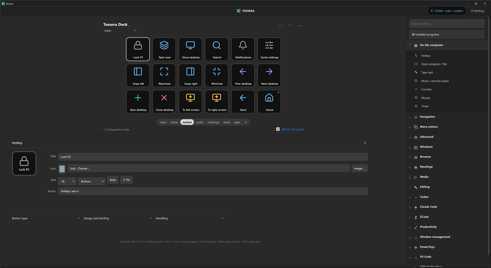
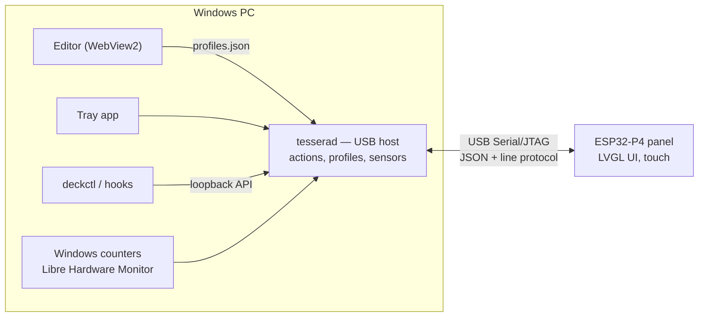

<h1 align="center">
  
</h1>

<p align="center">
  <strong>A touchscreen macro deck for the ESP32-P4 — live gauges, real app icons and a Stream&nbsp;Deck-style Windows host.</strong>
</p>

<p align="center">
  
  
  
  
  
</p>

<p align="center">
  
</p>

Tessera turns the 1024 × 600 touchscreen of the **GUITION 7-inch ESP32-P4 display board** into an 18-key control surface:
launch apps, fire hotkeys, drive Codex and Claude Code, watch live system gauges and run multi-step macros.
A small Windows host owns the USB connection, runs the actions and serves a drag-and-drop editor that always
shows exactly what the panel shows.

> [!IMPORTANT]
> **Made for one board:** the **GUITION 7-inch IPS display dev board** (ESP32-P4 + ESP32-C6, 1024 × 600
> capacitive multi-touch screen), bought from [this AliExpress listing](https://www.aliexpress.com/item/1005010022828767.html).
> The firmware runs on Espressif's ESP32-P4 Function EV Board support package, and the pin setup and screen layout
> are written for this exact kit, so other ESP32 boards or displays will not work without porting.
> You also need a Windows 10/11 PC and a USB cable to the board's USB Serial/JTAG port.

<p align="center">
  <br>
  <sub>The board Tessera is made for (image from the seller's listing).</sub>
</p>

## Highlights

- **Fast, flicker-free panel UI** — a fixed 6 × 3 grid rendered by LVGL. Live values update in place; the grid is never rebuilt while you touch it.
- **Real app icons** — rendered by the Windows shell at 256 px (Store apps, shortcuts and aliases included) and scaled to the panel, plus 1,895 bundled [Lucide](https://lucide.dev) icons and your own PNG, JPEG, GIF and WebP images.
- **Live ring gauges** — CPU, GPU, VRAM, RAM, disk, network, uptime, temperatures, power and fan speed, with amber and red thresholds.
- **A WYSIWYG editor** — drag and drop, undo/redo, copy/paste, folders, pinned buttons, toggle buttons with 2–8 states and multi-step actions. The editor mirrors the panel and follows it when the profile changes.
- **119 ready-made actions and 10 profile templates** for Windows, windows and desktops, PowerToys, GitHub Desktop, VS Code, browsers, meetings (Teams, Zoom, Discord), media, Codex, Claude Code and ZCode.
- **Keys that follow the PC** — the microphone, speaker and media buttons show the real Windows state (muted, live, playing) and flip on their own, and labels can show the current track and volume.
- **Smart profiles** — the panel switches profile by the foreground program, process or window title, and returns to the profile you had before when that program loses focus.
- **Long press and double press** — a key can have a second action (`hold_actions`, or the *Long-press hotkey* field in the editor) that runs when you hold it for about half a second, and a third (`double_actions`, or the *Double-press hotkey* field) for two quick taps. A key with a double-press waits about a third of a second before its normal action runs.
- **Scriptable** — a local control API and the `deckctl` command line let hooks and scripts set variables, colors, button states and pages (for example a Claude Code status light).
- **Tray app, auto-dim and brightness** — start with Windows, dim after inactivity or when the PC locks, and wake with a touch that does not trigger a button.
- **Free sensors** — Windows performance counters out of the box; the graphics driver fills in GPU temperature, power, fan speed and clock without administrator rights (AMD through ADL, NVIDIA through `nvidia-smi`); [Libre Hardware Monitor](https://github.com/LibreHardwareMonitor/LibreHardwareMonitor) adds the CPU temperature and power. `Tessera.cmd --sensors` makes it start at every sign-in (one Windows prompt); `--sensors-off` undoes it.
- **Counters and timers** — `counter` and `timer` actions with labels (`$(counter:laps)`, `$(timer:tea)`), a countdown ring, notifications and end actions. They are saved, and a running timer keeps counting while Tessera is closed.
- **Your own look** — background, label and outline colors per key, an image cropper, and optional online icon search (Iconify) next to the 1,895 offline icons.
- **Ambient screen and offline layout** — an idle clock built from brand-colored tiles (with optional weather from Open-Meteo for a city you choose); the panel remembers its last layout and shows it even when the PC is off.
- **Test before you press** — *Test (dry run)* explains what a key would do, checks paths, hotkeys and web addresses, and runs nothing.
- **Safe by default** — verified device identity, a bounded action queue, long commands that never block other keys, import review, rotating backups with restore and configuration versioning.
- **Integrations** — plugins with their own limited API tokens ([`docs/PLUGINS.md`](docs/PLUGINS.md)) and adapters that turn Claude Code hooks and Codex notifications into key states.
- **Easy upkeep** — panel firmware installer with verified packages and an update check, `Tessera.cmd --setup`, `--uninstall` and `--diagnostics`.

## Screenshots

| Editor — status page with live gauges | Editor — system page |
|---|---|
|  |  |

*Screenshots of the real editor window with a connected panel. The keys show what the panel shows; the settings of the selected key are under them and the action list is on the right.*

## How it works



The host is the **only owner of the USB port**. It pushes the active page (button layout, live values and
images) to the panel, receives key presses, runs the configured actions on the PC and confirms the result with a
green or red flash on the key. Everything is local: the editor and the control API listen on `127.0.0.1` only.

## Hardware

| Part | Notes |
|---|---|
| Board | GUITION 7-inch ESP32-P4 display dev board (ESP32-P4 + ESP32-C6) |
| Display | 1024 × 600 MIPI-DSI panel (JD9165) with GT911 capacitive touch |
| Connection | USB cable to the board's USB Serial/JTAG port — no Wi-Fi is needed |
| PC | Windows 10/11, Python 3.11 or newer |

## Quick start

### 1. Start Tessera

```powershell
Tessera.cmd            # everything: tray icon, USB host and the editor window
```

That is the whole program. The first run creates a Python environment. Closing the editor window leaves the tray
icon and the USB host running; start `Tessera.cmd` again to bring the editor back, or quit from the tray menu.
Enable **Start with Windows** in the tray menu to have it ready after every sign-in.

Optional entry points: `Tessera.cmd --terminal` (terminal UI), `--tray` (tray and host only) and `--editor`
(editor window only). `--setup` installs the dependencies and puts a shortcut on the Desktop, `--uninstall`
removes the autostart entry and the shortcut (add `--purge` to delete your profiles, icons and backups too) and
`--diagnostics` writes a support bundle with versions, counts and a cleaned log tail, and no button contents.
Dependencies are installed again only when `host/requirements.txt` changes.

The default port is `COM4`; set `TESSERA_PORT` to change it. After the first successful connection Tessera
remembers the board's USB serial number and follows it if Windows renumbers the port.

### 2. Flash the firmware

**From a release (no developer tools):** download `tessera-firmware-<version>.zip` from the Releases page (or press
*Check for updates* in **⋯ → Panel firmware …**), choose it there and press *Install*. The installer verifies the
package, the board and the protocol before writing. See [`docs/RELEASING.md`](docs/RELEASING.md) for how updates
and the lack of an automatic rollback work.

**From source:** install [ESP-IDF 6.1](https://docs.espressif.com/projects/esp-idf/en/v6.1/esp32p4/get-started/index.html), then:

```powershell
idf.py -B build/idf6 build
idf.py -B build/idf6 -p COM4 flash          # first time: bootloader, partition table and app
```

To update only the application — which keeps the bootloader, partition table and stored settings — stop the
host first (it owns the port) and write the app image:

```powershell
python -m esptool --chip esp32p4 -p COM4 -b 460800 write-flash 0x10000 build\idf6\tessera.bin
```

### 3. Make it yours

Open the editor, pick a program from **Installed programs** and drop it on a key. Changes are saved
automatically after validation to `host/profiles.json`, which is created from `host/profiles.default.json` on the
first start.

## Using Tessera

### Profiles, pages and actions

A **profile** holds pages; a **page** holds up to 18 keys; slot 18 is the pinned **Home** key. Folders push a page
with a *Back* key in slot 17. A key runs one or more actions in order:

| Action | What it does |
|---|---|
| `hotkey` | Press a key combination or media key |
| `text` | Type text |
| `open` | Open a program, file, folder or URL (optionally focus an already running program) |
| `shell` / `http` | Run a command or call an HTTP endpoint |
| `delay` | Wait between steps |
| `folder`, `back`, `home`, `page`, `profile` | Navigate |
| `press` | Run another key |
| `set` | Set a variable |
| `state` | Set the state of a toggle key (`next` or a state number) |

Labels can use `$(time)`, `$(date)`, `$(profile)`, `$(page)`, `$(agent:claude)`, `$(var:name)` and the live PC values `$(pc:mic)`, `$(pc:speaker)`, `$(pc:volume)`, `$(pc:track)`, `$(pc:artist)`, `$(pc:media)` and `$(pc:playing)`.
A toggle button can follow the PC instead of the presses with `"bind": "mic_muted" | "speaker_muted" | "media_playing"` (state 1 = off, state 2 = on), and the `audio` action (`target`: `mic` or `speaker`, `op`: `toggle`, `mute` or `unmute`) mutes the real device. Profiles switch
automatically with rules such as `chrome.exe`, `process:claude.exe` or `title:codex`.

### Live gauges and sensors

A key becomes a gauge with a `gauge` block; the host fills in the value, the ring and the color:

```json
{
  "label": "CPU TEMP",
  "gauge": { "key": "cpu_temp", "max": 100, "unit": "C", "warn": 80, "critical": 90 }
}
```

Formats are `int`, `ghz`, `gb`, `rate`, `uptime` and `live`; `scale: "log"` suits network rates.

| Source | Needs | Provides |
|---|---|---|
| Windows | nothing | CPU load, RAM, disk, network, uptime, GPU load, VRAM, CPU clock |
| Libre Hardware Monitor | free download, administrator rights | temperatures, CPU and GPU power, fan speed, clocks |

Install the optional sensor source with `tools\setup_sensors.ps1`. It downloads the official release, verifies
its SHA-256, enables the remote web server on `127.0.0.1:8085` and starts it (Windows asks for confirmation
once). Until it runs, the sensor tile shows `BASIC` and the affected gauges show `--`.

### Brightness and auto-dim

Open **Settings** in the editor, or the tray menu. By default the panel dims to 10 % after five minutes without
a press and when Windows locks; the first touch anywhere on the screen wakes it without pressing a key. The panel
remembers the brightness across restarts. Set the values in
`profiles.json` with `"display": { "brightness": 80, "dim_after": 300, "dim_level": 10 }` (`dim_after: 0` disables it).

### Control from scripts and AI tools

The host publishes a per-run token in `host/deck-api.local.json`; `host/deckctl.py` uses it:

```powershell
python host\deckctl.py var claude working     # labels can use $(var:claude)
python host\deckctl.py state 3 next           # set a toggle key's state
python host\deckctl.py page main status       # show a page
python host\deckctl.py press 5 | ok 5 | alert 5 | wake | dim | status
```

A key can change color with a variable: `"status": { "var": "claude", "colors": { "working": "#FFB74D" } }`.
The Claude Code profile uses this on its first key.

**Claude Code.** `python host\deckctl.py hooks claude` prints the `hooks` block for `~/.claude/settings.json`
(Tessera never edits your settings itself; merge it yourself). Every hook runs `deckctl adapter claude`, which reads
the hook's JSON from stdin and sets `$(var:claude)` (`working`, `waiting`, `idle`, `ended`), `$(var:claude.tool)`,
`$(var:claude.project)` and `$(var:claude.message)` (the text of a notification, for example a permission prompt).
It always exits 0, so a stopped host never disturbs Claude Code. Check the event names against the Claude Code
hooks documentation for your version.

**Codex.** Codex reports only finished turns through its `notify` setting: point it at
`python host\deckctl.py adapter codex` and `$(var:codex)`, `codex.project` and `codex.message` are set when a turn
completes. While Codex works, the key still shows `$(agent:codex)` from process detection; Codex offers no
"working" event to read.

**Any other tool.** `python host\deckctl.py adapter generic NAME STATE [MESSAGE]` sets `$(var:NAME)` and
`$(var:NAME.message)`. Adapters live in `host/adapters.py`; adding one is a function from the tool's event to
`{variable: value}`.

**Your own program.** Write a [plugin](docs/PLUGINS.md): a separate process with its own limited token that sets
values, reads key presses and receives commands from a key.

### Real icons for existing keys

`python tools\refresh_program_icons.py` gives every program key the icon `"app"`, which the host resolves from
the key's `open` action. It is a dry run by default; add `--apply` to write the changes (the old file is kept as
`profiles.backup.local.json`) or `--freeze` to store the images instead.

## Serial protocol

115200 baud over USB Serial/JTAG. Lines are UTF-8; the panel answers every command.

| Direction | Message | Purpose |
|---|---|---|
| host → panel | `{"cmd":"get_info"}` | Board id (`tessera-p4`), firmware, boot id, memory |
| host → panel | `AD_CFG_BEGIN` / `AD_CFG_DATA …` / `AD_CFG_END` | Push the button layout (JSON, chunked) |
| host → panel | `AD_IMG_BEGIN` / `AD_IMG_DATA` / `AD_IMG_END` | Upload a button image (CRC-checked) |
| host → panel | `AD_CONTEXT {…}` | Profile, page and back-arrow state for the header |
| host → panel | `AD_FEEDBACK <ok or alert> <id>` | Flash a key green or red |
| host → panel | `AD_BRIGHTNESS <1-100>`, `AD_DISPLAY_DIM <0-100>`, `AD_DISPLAY_WAKE` | Backlight control; the brightness is stored on the panel |
| host → panel | `AD_PING` | Heartbeat every second; the header shows *NO PC* after 3.5 s without one |
| host → panel | `AD_TIME YYYY-MM-DDTHH:MM:SS` | The PC's local time for the header and the ambient clock; the panel has no network clock |
| host → panel | `AD_SCREEN deck` / `AD_SCREEN ambient` | Show the keys or the ambient clock (protocol 3) |
| host → panel | `AD_AMBIENT <text>` | The line under the ambient clock, for example the weather (protocol 3) |
| panel → host | `{"type":"info","boardId":"tessera-p4","firmwareVersion":…,"protocol":3,…}` | The answer to `get_info`; the host refuses another board or an unsupported protocol |
| panel → host | `{"type":"deck_event","button":N,"label":"…","hold":true}` | A key was pressed (`hold` for a long press, protocol 2) |
| panel → host | `{"type":"wake"}` | A touch woke the dimmed panel; it presses no key |
| panel → host | `{"type":"screen","name":"deck","by":"touch"}` | A touch left the ambient screen (protocol 3) |

Layout entries may also carry `hold` (the key has a long-press action) and `bg`, `text_color` and `border` colors.
A layout is limited to 8 KB and up to 18 keys; an image upload answers `AD_IMG_END OK <id>`, `INVALID` or `FULL`
(the 8 MiB image cache cannot hold it). Protocol versions are listed in [`docs/RELEASING.md`](docs/RELEASING.md).

A pressed key stays highlighted until the host confirms it with `AD_FEEDBACK`. Without a host it flashes red at once.

The `AD_` prefix is the protocol's historical namespace and is kept for compatibility.

## Project layout

```text
main/            ESP32-P4 firmware: USB console, button model, LVGL UI, fonts, image decoder
components/      Board support package for the ESP32-P4 Function EV Board
host/            Windows host
  tesserad.py          USB daemon: actions, profiles, sensors, dimming, control API
  tessera_app.py       Local editor server and WebView2 window
  tessera_terminal.py  Terminal UI
  tessera_tray.py      Tray app
  deckctl.py           Command line for the control API, adapters and hooks
  control_api.py       Local API with scoped tokens and the event stream
  action_runner.py     Bounded, killable command execution
  live_state.py        Counters and timers      pc_state.py   Microphone, speakers, media
  ambient.py           Idle screen line and weather     adapters.py   AI tool adapters
  plugins.py           Plugin manifests and lifecycle   config_store.py   Versions and backups
  firmware_update.py   Firmware packages and installer  updates.py   Update check
  import_review.py     Import approval      action_preview.py   Dry run
  setup_tool.py        Setup, uninstall, dependency sync
  editor/              Editor front end (HTML, JS, CSS)
plugins/         Plugins (example-uptime is a working reference)
docs/            Plugin guide, release process, SmartDeck comparison, images
tests/           Unit, editor, native render and hardware smoke tests
tools/           Packaging, icon refresh, sensor setup and icon font tooling
vendor/          Lucide icon pack (ISC) and ArduinoJson (MIT)
```

## Development

```powershell
host\.venv\Scripts\python.exe -m unittest discover -s tests -p test_*.py -v
host\.venv\Scripts\python.exe host\tessera_terminal.py --check

cmake -S tests/native -B build/native -G Ninja -DCMAKE_BUILD_TYPE=Release
cmake --build build/native
build\native\test_ui.exe build\previews          # renders the real LVGL UI to images

host\.venv\Scripts\python.exe tests\hardware_smoke.py   # talks to the panel; presses no keys on the PC
```

The hardware smoke test never sends hotkeys or runs actions on the PC. GitHub Actions runs the Windows host
tests, a lint and dependency audit, the firmware build and the native LVGL tests on every push. See
[`VERIFICATION.md`](VERIFICATION.md) for what the checks cover and what has not been run on hardware,
[`CHANGELOG.md`](CHANGELOG.md), [`docs/SMARTDECK_COMPARISON.md`](docs/SMARTDECK_COMPARISON.md) and
[`ELGATO_RESEARCH.md`](ELGATO_RESEARCH.md) for the design research.

## Troubleshooting

| Symptom | Fix |
|---|---|
| The panel stays black but touch works | A touch wakes a dimmed panel; if it stays black, restart the host, which also wakes the backlight on connect |
| The header says *NO PC* | The host is not running or does not own the port; start it from the tray |
| `Another Tessera host is already running` | Only one host may own the port; stop it from the tray, then start again |
| Gauges show `--` | Temperature, power and fan need Libre Hardware Monitor (`tools\setup_sensors.ps1`) |
| The editor looks out of date | Close the editor window and open it again from the tray |
| Flashing fails with *port busy* | Stop the host first; it holds the COM port |

## Security notes

Profiles can run commands, open files and call URLs, so **treat imported profiles like code**. Importing lists every
command, web request, program launch and automatic rule and asks before keeping them (you can import without them).
The editor and the control API accept connections from `127.0.0.1` only, require a per-run token and reject
browser requests. Variable values are refused in shell commands when they contain characters like `& | < > ^ " %`
and are percent-encoded in URLs. Keep API keys out of profiles: write `$(env:NAME)` in an HTTP header or body and
set the variable in Windows; exports replace known credential headers with such references.
Plugins run with your own rights and are not sandboxed; the limited tokens only restrict what they can ask
Tessera to do. Only the project's own GitHub releases, `api.open-meteo.com` and `api.iconify.design` are ever
contacted, each only after you ask for it (update check, weather, online icons).

## Roadmap

Not done yet, in rough order of value:

- Run the 0.5.0 firmware on the panel and fix what only hardware shows (see `VERIFICATION.md`)
- A real A/B firmware layout with over-USB OTA and automatic rollback (see `docs/RELEASING.md`)
- Counters and timers that tick on the panel itself, without the PC
- Press-and-release (key-down / key-up) actions, for example push-to-talk; today a long press runs a second action
- Sliders and other touch widgets beyond the key grid
- Import of Stream Deck and OpenDeck profiles; OpenAction/OpenDeck plugin compatibility (not built, so not claimed)
- A signed Windows installer

## Acknowledgements

Built with [ESP-IDF](https://github.com/espressif/esp-idf), [LVGL](https://lvgl.io), the Espressif board support
package, [Lucide](https://lucide.dev) icons (ISC), [ArduinoJson](https://arduinojson.org) (MIT) and DejaVu fonts.
Optional sensors come from [Libre Hardware Monitor](https://github.com/LibreHardwareMonitor/LibreHardwareMonitor)
(MPL-2.0). Tessera is inspired by Stream Deck and [OpenDeck](https://github.com/nekename/OpenDeck) and is not
affiliated with Elgato or Corsair; Stream Deck is a trademark of its owner.

## License

No license has been chosen yet, so all rights are reserved by the author until one is added. Third-party
components keep their own licenses (see `vendor/lucide/LICENSE` and the component directories).
