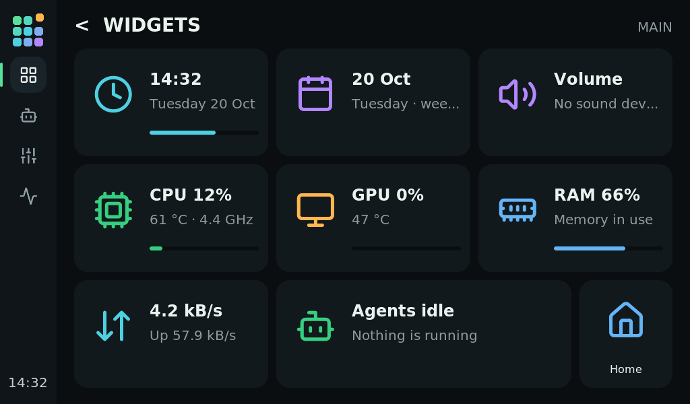
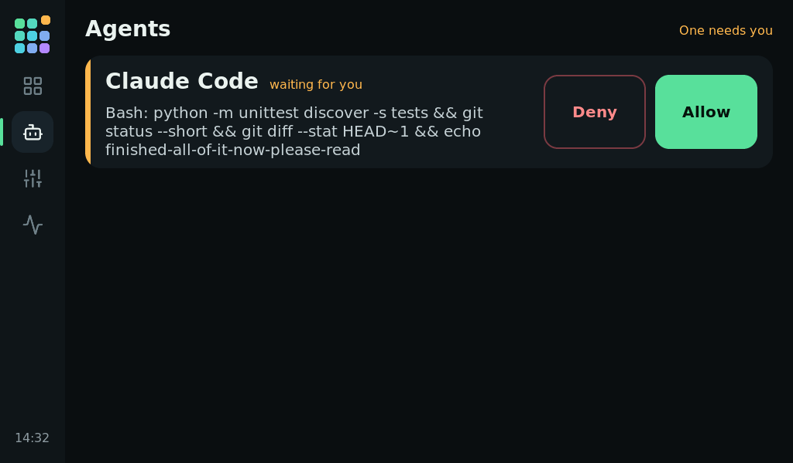
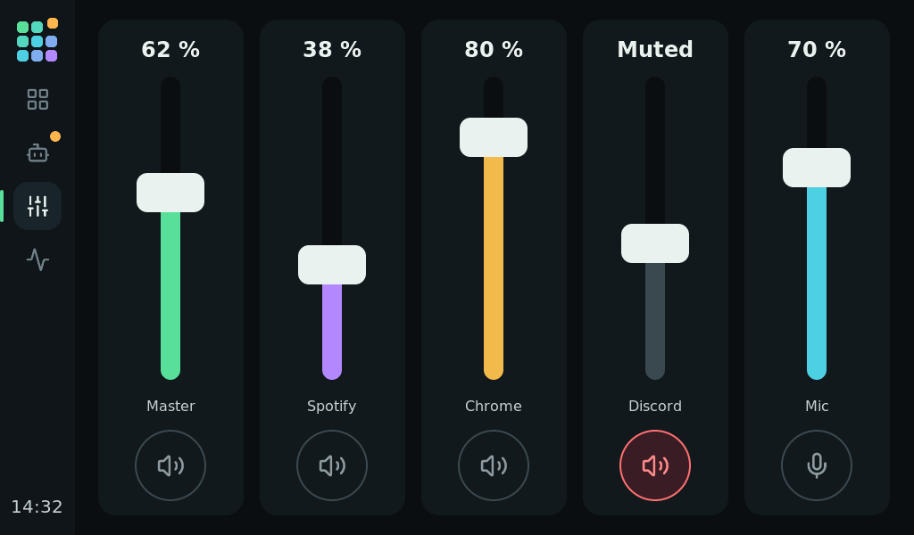
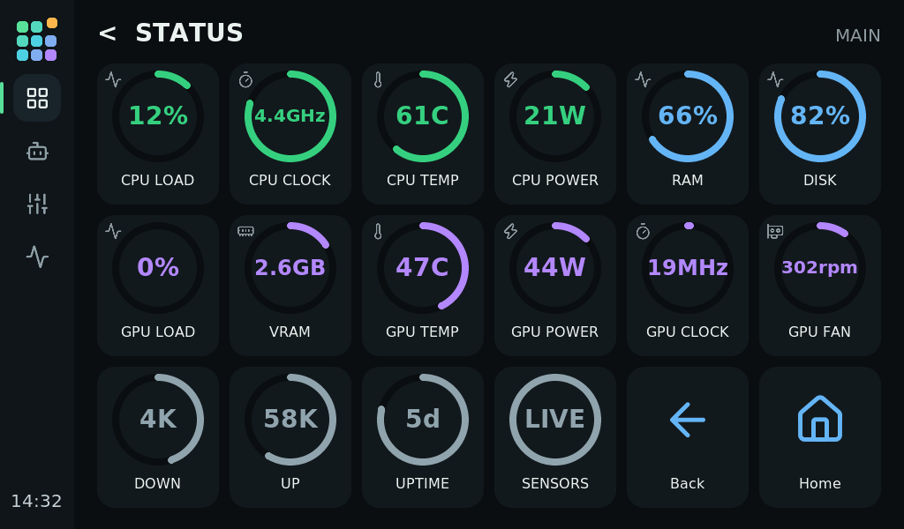
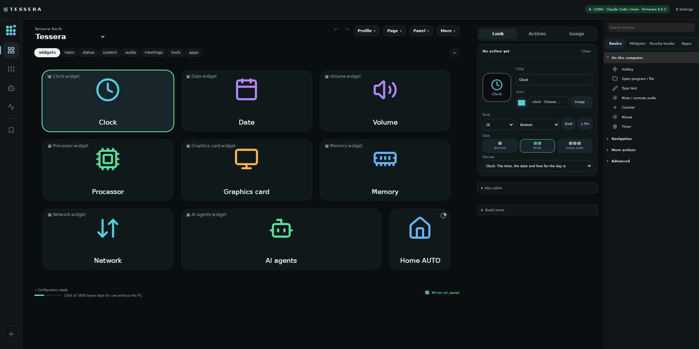
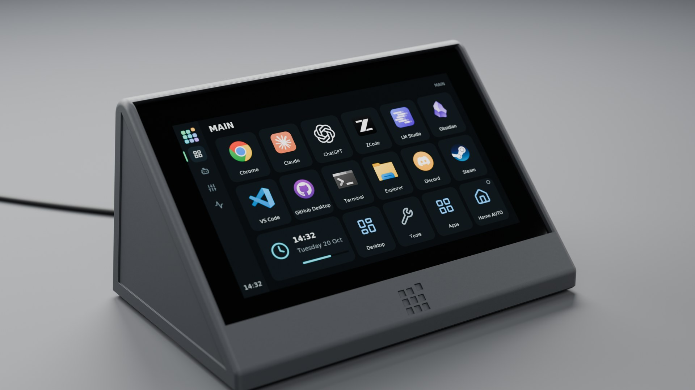
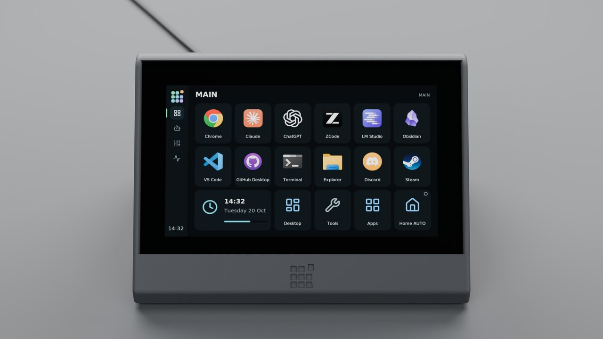
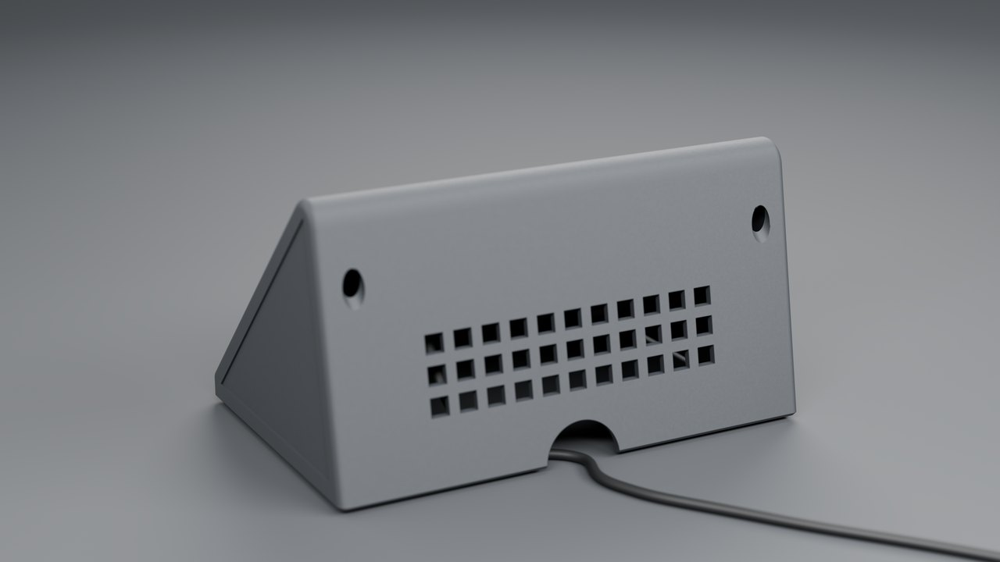
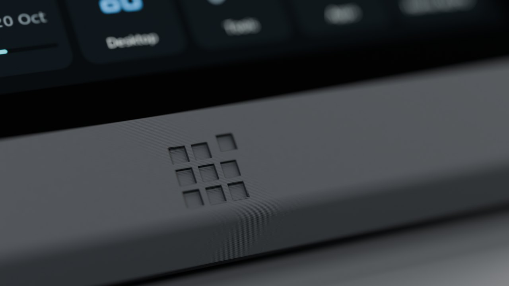
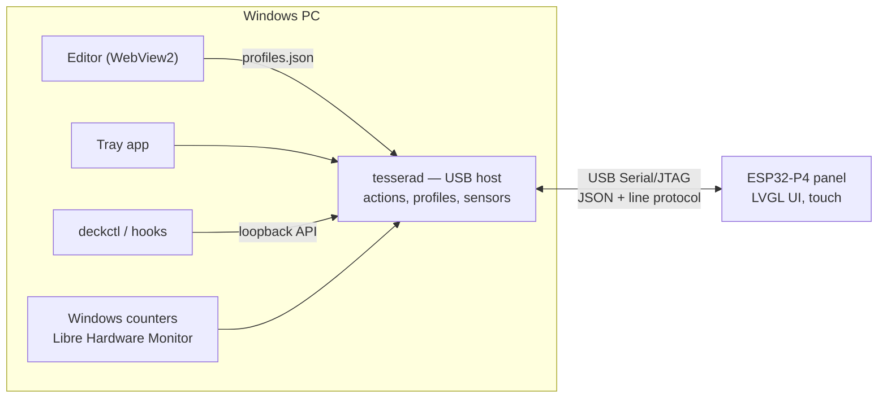

<h1 align="center">
  
</h1>

  <strong>A DIY Stream&nbsp;Deck: turn a 7-inch ESP32-P4 touchscreen into an open-source macro deck for Windows.</strong>

  Two 7-inch ESP32-S3 boards have an experimental build that has not been tested on S3 hardware yet: <a href="docs/S3.md">ESP32-S3 boards</a>. If you have one, <a href="https://github.com/catorendal-a11y/tessera-deck/discussions/6">tell me how it goes</a>.

  
  
  
  
  
  
  

  

Tessera is a macro deck for Windows that you build from one 7-inch touchscreen board. It has 18 touch keys for apps, hotkeys and macros, plus widgets, live PC gauges, an AI agents screen and a sound mixer. You set it up in a drag-and-drop editor. It needs no soldering, and a [printed console](#a-desk-console-to-print) holds it on the desk.

> [!IMPORTANT]
> You need the [GUITION 7-inch ESP32-P4 display dev board](https://www.aliexpress.com/item/1005010022828767.html) (model JC1060P470C, 1024 × 600, about $35 to $42), a USB cable and a Windows 10/11 PC. Other boards need porting, and the host runs on Windows only.

## In short

- When Claude Code asks for permission, the question shows on the panel and you touch *Allow* or *Deny* to answer. The agents screen also shows what Claude Code, Codex and ZCode are doing, since when, and in which project.
- There is no account, cloud service or subscription. Your profiles stay on your PC, and the host goes online only for features you turn on, such as the update check or the weather. [Security](SECURITY.md#what-tessera-contacts) lists every address. The panel talks to a small Windows host over USB.
- Firmware, host and editor are open source (MIT), with over 600 automated tests, a documented serial protocol and a plugin API.
- It needs one board, which you flash from the editor without a toolchain. See [Build it or buy one?](#build-it-or-buy-one)

| Widgets on wide keys | Answer Claude Code from the panel |
|---|---|
|  |  |

| Sound mixer | Live status page |
|---|---|
|  |  |

  

The panel images are drawn by the firmware UI itself in a native build (`tools/render_screens.py` and `test_ui`). The agents and mixer screens show sample data. The editor images are screenshots of the real editor.

## Quick start

The release zip has the host and the panel firmware, so you need no build tools.

1. Unpack `tessera-host-<version>.zip` from the [latest release](https://github.com/catorendal-a11y/tessera-deck/releases/latest) and double-click `Tessera.cmd`. The first start sets everything up and puts a shortcut on the Desktop. The editor opens.
   Windows SmartScreen may warn about the download because Tessera is not code-signed. You can compare the zip's SHA-256 with `SHA256SUMS` first, as [Install](docs/INSTALL.md#download-and-verify) explains. If no Python 3.11 or newer is found, the first start installs Python 3.12 for your user with winget and accepts its license terms.
2. Connect the panel with USB. The *Getting started* checklist in the editor ticks off *Host running* and *Panel connected* by itself.
3. Open **Panel → Panel firmware and updates …** and choose the included firmware. A new board needs *Full install (new or blank panel)*, then *Install anyway*. Press *Install*. More in [Install](docs/INSTALL.md).
4. Click an action in the list on the right. It becomes a new key. Fill it in on the **Look** and **Actions** tabs. Changes are saved automatically.
5. Press the key on the panel. The editor says "It works" and lights up the key.

Nothing runs in the editor. Keys run only when you press them on the panel.

## Build it or buy one?

| | Tessera | Stream Deck MK.2 | Stream Deck XL |
|---|---|---|---|
| Price | the board, about $35–42 | $149.99 | $249.99 |
| Keys | 18 per page on a 7-inch touchscreen, keys up to three slots wide | 15 physical keys | 32 physical keys |
| Live widgets, mixer, PC status, AI agents | built in | through plugins | through plugins |
| Source code | MIT | closed | closed |

You also need a USB-C cable, and a stand helps: print the [desk console](#a-desk-console-to-print) or use a small tablet stand. Tessera is glass, so you give up the feel of a real key. A key shows it is pressed as soon as your finger lands and runs its action when you lift it. Drawing the whole screen takes about 55 ms; [Verification](VERIFICATION.md#screen-speed) has the measurements. Board prices are AliExpress street prices and the Stream Deck prices are US list prices, both from November 2026, so they may have changed.

## What it does

- Four screens on the panel: your keys, the AI agents, a sound mixer and the PC's status. A side bar you arrange yourself switches between them.
- Wide keys and widgets: a key can cover two or three slots and show the clock, the date, CPU, GPU, memory, network, volume, the AI agents, your next meeting, the music that plays or a timer.
- Icons: real app icons from Windows, 1,895 Lucide icons or your own images.
- Live gauges: CPU, GPU, VRAM, RAM, disk, network, temperatures, power, fan and FPS.
- Profiles that follow the program in front, with a lock key to stay put.
- Over 120 ready-made actions and 10 profile templates for Windows, VS Code, browsers, meetings, media, Codex, Claude Code and ZCode.
- Macros: multi-step actions, long press, double press, hold to confirm, toggle keys, counters and timers.
- Scripts and AI tools: drive keys from your own scripts with the local API or `deckctl`, or add plugins (one for Home Assistant through the PC and one for OBS Studio are included) and Claude Code hooks.
- Clock screen, offline layout, auto-dim and a firmware installer.
- Home Assistant over Wi-Fi (beta, not in the release yet): the panel joins your Wi-Fi and shows up in Home Assistant through the ESPHome integration. See [below](#home-assistant-beta).

See [all features](docs/FEATURES.md).

## Home Assistant (beta)

This is not in the release yet. On the [`esphome-beta`](https://github.com/catorendal-a11y/tessera-deck/tree/esphome-beta) branch, the panel can also join your Wi-Fi and show up in Home Assistant through the ESPHome integration. USB to Windows keeps working as before, so one panel does both.

- Keys run Home Assistant actions straight from the panel, also when the PC is off: toggle a light, start a scene or call any other action.
- Keys can follow an entity: a key can change color while a light is on, or show a value such as 21.5 °C as its label.
- Every key is also an event (press, hold, double press) for your automations, and there are entities for the backlight, the page, the Wi-Fi signal and whether the PC is connected.
- The connection is encrypted. Home Assistant discovers the panel over mDNS and asks for its key. Wi-Fi and Home Assistant stay off until you turn them on in *Panel → Wi-Fi and Home Assistant*.

The beta runs on one panel and works with aioesphomeapi, the library Home Assistant uses to talk to ESPHome devices, but it has not been tried in a full Home Assistant install yet. To try it:

1. Check out the branch and start Tessera.
2. Install the panel firmware from the branch with *Full install*. It needs the host from the same branch.
3. Open *Panel → Wi-Fi and Home Assistant*.

To go back, check out `main` again and install its firmware with *Full install*. *Update* does not work on the beta firmware, because the host on main cannot talk to it. Your profile file still loads there: it keeps the Wi-Fi and Home Assistant settings and steps, and keys skip those steps until you switch to the beta again. Main does not check the beta's limits for one page (24 Home Assistant steps and 4,096 bytes of them, pinned keys included). If you copy or pin keys with those steps on main and a page goes past them, the beta starts with an older backup instead.

Reports in [issues](https://github.com/catorendal-a11y/tessera-deck/issues) are welcome. The [design](https://github.com/catorendal-a11y/tessera-deck/blob/esphome-beta/docs/design/esphome.md) explains how it works.

## A desk console to print

  

| From your chair | The back | The tile mark |
|---|---|---|
|  |  |  |

The panel drops into a printed console that reclines it 45° and hides the cables, or into a lighter open dock. The console prints without supports; the dock should too. [hardware/](hardware/README.md) has the STL and STEP files, the CAD models, the print settings and how the panel is fastened.

The pictures are rendered in Blender from the CAD model, with the panel's real screen. [`make_render.py`](hardware/make_render.py) builds the scene, saves it as [`tessera-console.blend`](hardware/tessera-console.blend) and renders it in 4K. See [Render the console](hardware/README.md#render-the-console).

## How it works

The host is the only owner of the USB port. It sends the page to the panel, receives key presses and runs the actions on the PC. The editor and the control API listen on `127.0.0.1` only.

## Documentation

| | |
|---|---|
| [Features](docs/FEATURES.md) | Everything Tessera does, by panel screen and editor area |
| [Install](docs/INSTALL.md) | Hardware, start options, flashing from source |
| [Desk console](hardware/README.md) | A printable stand for the panel: STL, STEP, the CAD models and a Blender scene for renders |
| [Using Tessera](docs/USING.md) | Actions, labels, gauges, sensors, brightness, scripts, troubleshooting |
| [Plugins](docs/PLUGINS.md) | Write your own integration |
| [Serial protocol](docs/PROTOCOL.md) | What the host and the panel say to each other |
| [Development](docs/DEVELOPMENT.md) | Project layout, tests and tools |
| [Contributing](CONTRIBUTING.md) | Reporting bugs, sending changes, porting to another board |
| [Security](SECURITY.md) | Imported profiles, tokens and network use |
| [Verification](VERIFICATION.md) | What the tests cover, what was checked on a real panel and what nobody has tried yet |
| [ESP32-S3 boards](docs/S3.md) | The experimental port to two 800 x 480 S3 boards, not tested on S3 hardware yet |
| [Roadmap](docs/ROADMAP.md) | What is not done yet |

## Credits and license

Built with [ESP-IDF](https://github.com/espressif/esp-idf), [LVGL](https://lvgl.io), the Espressif board support
package, [cJSON](https://github.com/DaveGamble/cJSON) (MIT), [Lucide](https://lucide.dev) icons (ISC) and DejaVu fonts.
Optional sensors come from [Libre Hardware Monitor](https://github.com/LibreHardwareMonitor/LibreHardwareMonitor)
(MPL-2.0). Tessera is inspired by Stream Deck and [OpenDeck](https://github.com/nekename/OpenDeck) and is not
affiliated with Elgato or Corsair; Stream Deck is a trademark of its owner.

Tessera is released under the [MIT License](LICENSE). Third-party components keep their own licenses (see
`vendor/lucide/LICENSE` and the component directories).
