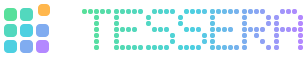
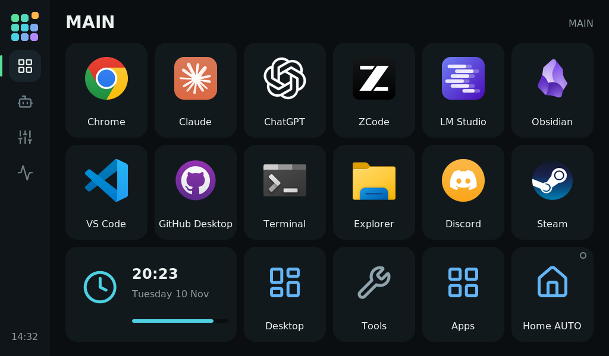
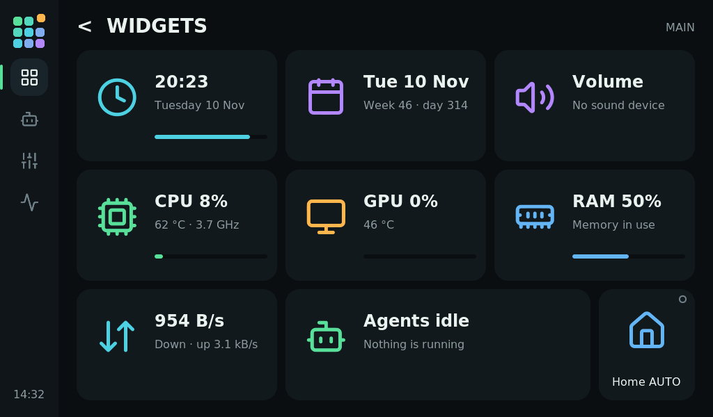
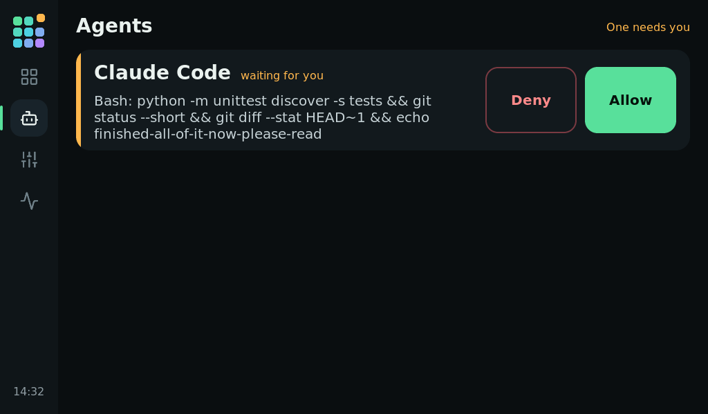
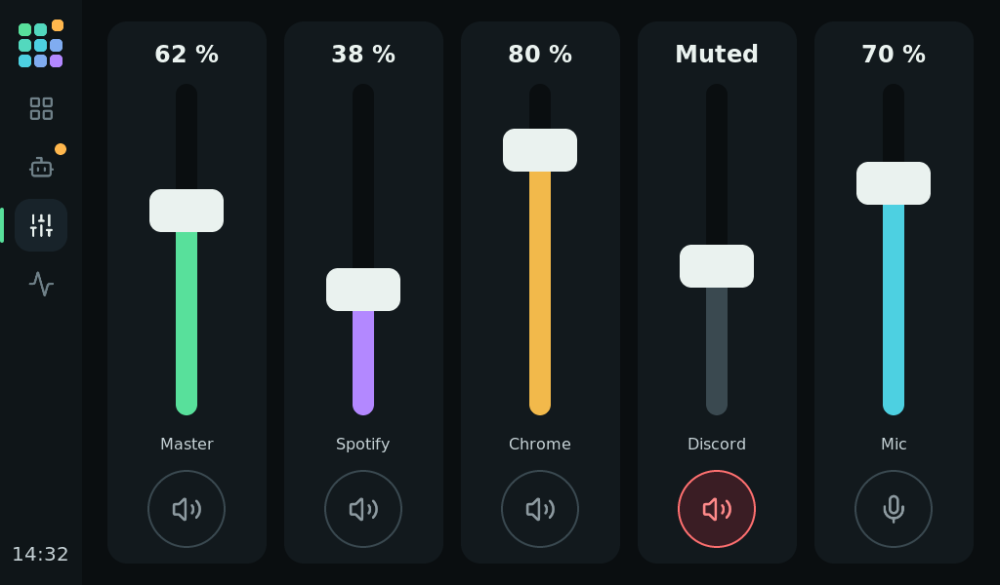
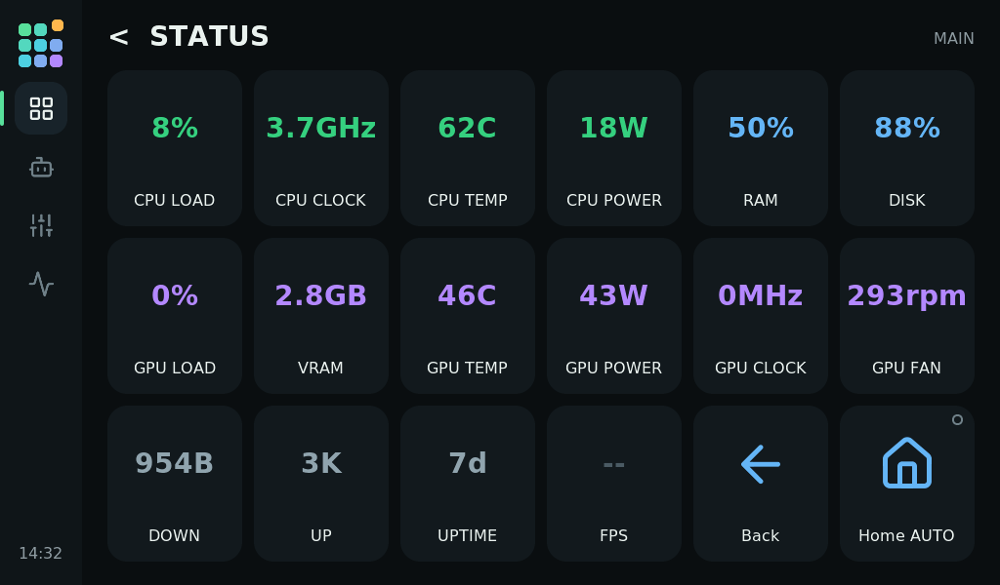
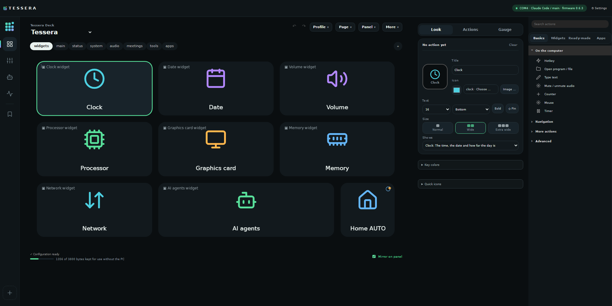
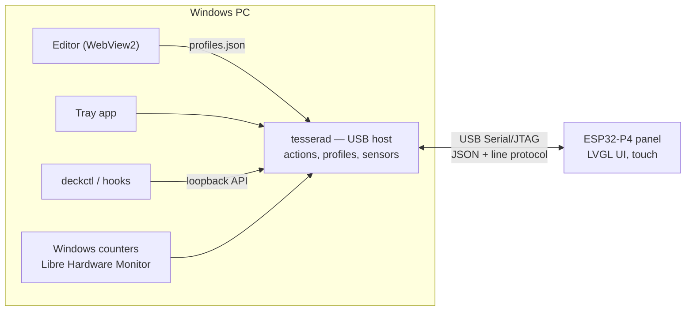

<h1 align="center">
  
</h1>

  <strong>Turn a 7-inch ESP32-P4 touchscreen into a Stream&nbsp;Deck-style macro deck for Windows.</strong>

  
  
  
  
  
  
  

  

18 touch keys for your apps, hotkeys and macros, with widgets, live PC gauges, an AI agents screen, a sound mixer and a drag-and-drop editor. Everything runs locally over USB.

| Widgets on wide keys | Answer Claude Code from the panel |
|---|---|
|  |  |

| Sound mixer | Live status page |
|---|---|
|  |  |

  

Panel images are drawn by the real firmware UI in a native build, not photographed. The agents and mixer screens show sample data.

> [!IMPORTANT]
> **Made for one board:** the [GUITION 7-inch ESP32-P4 display dev board](https://www.aliexpress.com/item/1005010022828767.html) (model JC1060P470C, 1024 × 600). Other boards need porting. You also need a Windows 10/11 PC and a USB cable.

## Why Tessera

- **It answers your AI agent.** When Claude Code asks for permission, the question shows on the panel and a touch on *Allow* or *Deny* answers it. The agents screen also shows what Claude Code, Codex and ZCode are doing.
- **Everything stays on your PC.** No account, no cloud and no subscription: the panel talks to a small Windows host over USB.
- **It is yours to change.** Firmware, host and editor are open source (MIT), with 480+ tests, a documented serial protocol and a plugin API.
- **One off-the-shelf board.** A 7-inch ESP32-P4 touchscreen (GUITION JC1060P470C), flashed from the editor. No soldering.

## Quick start

1. **Start Tessera.** Unpack `tessera-host-<version>.zip` from the [latest release](https://github.com/catorendal-a11y/tessera-deck/releases/latest) and double-click `Tessera.cmd`. The first start sets up everything, installs Python if it is missing and puts a shortcut on the Desktop.
2. **Flash the panel.** Connect it with USB and open **⋯ → Panel firmware …** in the editor. Choose the included firmware and press *Install*. A new board needs *Everything* and *Install anyway*; see [Install](docs/INSTALL.md).
3. **Add your apps.** In the action list, open **Apps → Installed programs …** and drop a program on a key. Changes are saved automatically.

## What it does

- **Four screens on the panel**: your keys, the AI agents (answer Claude Code's permission questions with Allow or Deny), a sound mixer and the PC's status, on a rail you arrange yourself
- **Wide keys and widgets**: a key can cover two or three slots and show the clock, the date, CPU, GPU, memory, network, volume, the AI agents, the music that plays or a timer
- **Real app icons** from Windows, 1,895 Lucide icons or your own images
- **Live gauges** for CPU, GPU, VRAM, RAM, disk, network, temperatures, power, fan and FPS
- **Smart profiles** that follow the program in front, with a lock key to stay put
- **119 ready-made actions and 10 templates** for Windows, VS Code, browsers, meetings, media, Codex and Claude Code
- **Multi-step macros**, long press, double press, toggle keys, counters and timers
- **Keys that follow the PC**, such as microphone, speaker and media state
- **Scripts and AI tools** through a local API, `deckctl`, plugins and Claude Code hooks
- **Clock screen and offline layout**, auto-dim and a firmware installer

See [all features](docs/FEATURES.md).

## How it works

The host is the only owner of the USB port. It sends the page to the panel, receives key presses and runs the actions on the PC. The editor and the control API listen on `127.0.0.1` only.

## Documentation

| | |
|---|---|
| [Install](docs/INSTALL.md) | Hardware, start options, flashing from source |
| [Using Tessera](docs/USING.md) | Actions, labels, gauges, sensors, brightness, scripts, troubleshooting |
| [Plugins](docs/PLUGINS.md) | Write your own integration |
| [Serial protocol](docs/PROTOCOL.md) | What the host and the panel say to each other |
| [Development](docs/DEVELOPMENT.md) | Project layout, tests and tools |
| [Contributing](CONTRIBUTING.md) | Reporting bugs, sending changes, porting to another board |
| [Security](SECURITY.md) | Imported profiles, tokens and network use |
| [Roadmap](docs/ROADMAP.md) | What is not done yet |

## Credits and license

Built with [ESP-IDF](https://github.com/espressif/esp-idf), [LVGL](https://lvgl.io), the Espressif board support
package, [Lucide](https://lucide.dev) icons (ISC), [ArduinoJson](https://arduinojson.org) (MIT) and DejaVu fonts.
Optional sensors come from [Libre Hardware Monitor](https://github.com/LibreHardwareMonitor/LibreHardwareMonitor)
(MPL-2.0). Tessera is inspired by Stream Deck and [OpenDeck](https://github.com/nekename/OpenDeck) and is not
affiliated with Elgato or Corsair; Stream Deck is a trademark of its owner.

Tessera is released under the [MIT License](LICENSE). Third-party components keep their own licenses (see
`vendor/lucide/LICENSE`, `vendor/arduinojson/LICENSE.txt` and the component directories).
