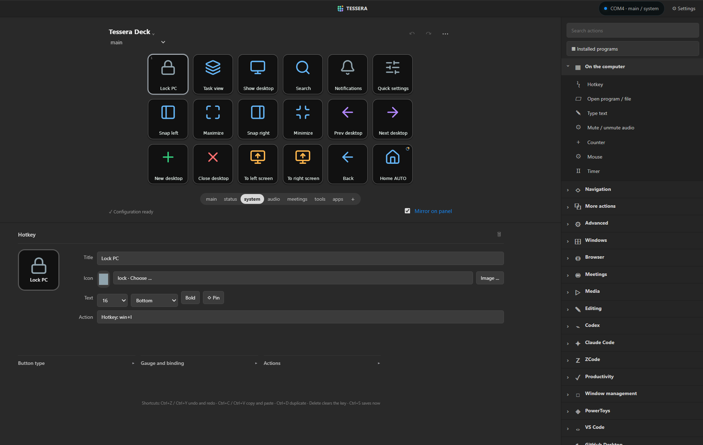
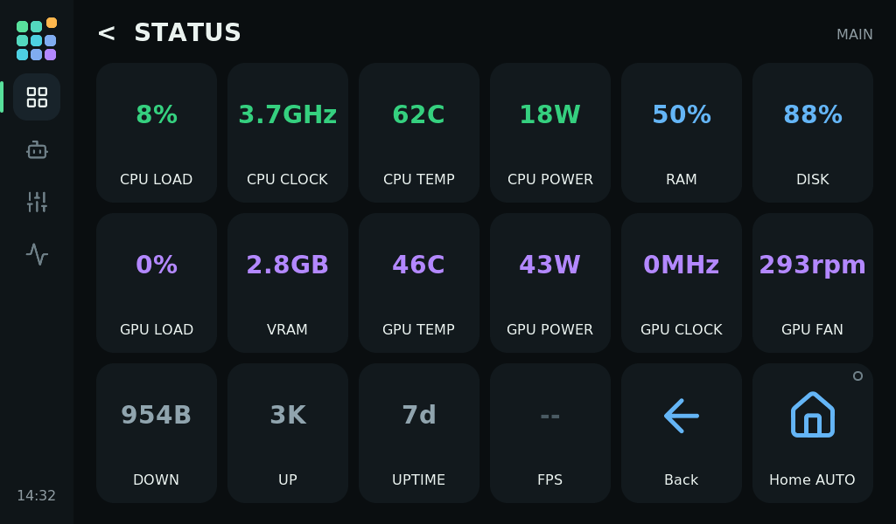
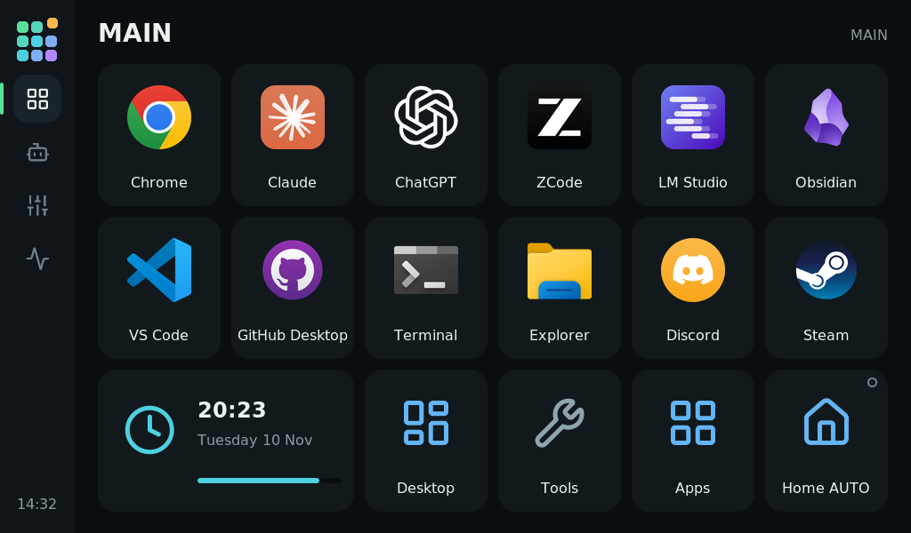

# Features

[Back to the README](../README.md)

Tessera turns the 1024 × 600 touchscreen of the **GUITION 7-inch ESP32-P4 display board** into an 18-key control surface:
launch apps, fire hotkeys, drive Codex and Claude Code, watch live system gauges and run multi-step macros.
A small Windows host owns the USB connection, runs the actions and serves a drag-and-drop editor that shows the
same keys as the panel.

  

| Editor — status page with live gauges | Editor — system page |
|---|---|
|  |  |

| Panel — status page | Panel — main page |
|---|---|
|  |  |

*The editor images show the real editor with this PC's sensor values. The panel images are drawn by the real firmware UI (LVGL) in a native build with `tools/render_screens.py`, not photographed.*

### On the panel

- **Fast, flicker-free panel UI** — a fixed 6 × 3 grid rendered by LVGL. Live values update in place; the grid is never rebuilt while you touch it.
- **Real app icons** — rendered by the Windows shell at 256 px (Store apps, shortcuts and aliases included) and scaled to the panel, plus 1,895 bundled [Lucide](https://lucide.dev) icons and your own PNG, JPEG, GIF and WebP images.
- **Live gauges** — CPU, GPU, VRAM, RAM, disk, network, uptime, temperatures, power, fan speed and FPS. The icon fills from the bottom with the value, a small badge says what is measured, and amber and red mark the thresholds.
- **Keys that follow the PC** — the microphone, speaker and media buttons show the real Windows state (muted, live, playing) and flip on their own, and labels can show the current track and volume.
- **Ambient screen and offline layout** — an idle clock built from brand-colored tiles (with optional weather from Open-Meteo for a city you choose); the panel remembers its last layout and shows it even when the PC is off.
- **Auto-dim and brightness** — dim after inactivity or when the PC locks, and wake with a touch that does not trigger a button.

### In the editor

- **A WYSIWYG editor** — keys on top, the settings of the selected key under them and the action list on the right, with drag and drop, undo/redo, copy/paste, folders, pinned buttons, toggle buttons with 2–8 states and multi-step actions. The editor follows the panel when the profile changes.
- **119 ready-made actions and 10 profile templates** for Windows, windows and desktops, PowerToys, GitHub Desktop, VS Code, browsers, meetings (Teams, Zoom, Discord), media, Codex, Claude Code and ZCode.
- **Your own look** — background, label and outline colors per key, an image cropper, and optional online icon search (Iconify) next to the 1,895 offline icons.
- **Test before you press** — *Test (dry run)* explains what a key would do, checks paths, hotkeys and web addresses, and runs nothing.

### Actions and automation

- **Smart profiles** — the panel switches profile by the foreground program, process or window title, and returns to the profile you had before when that program loses focus. A *Lock profile* key keeps the current profile until you press it again.
- **Long press and double press** — a key can have a second action (`hold_actions`, the *Held* tab in the editor) that runs when you hold it for about half a second, and a third (`double_actions`, the *Double-press* tab) for two quick taps. A key with a double-press waits about a third of a second before its normal action runs.
- **Counters and timers** — `counter` and `timer` actions with labels (`$(counter:laps)`, `$(timer:tea)`), a countdown ring, notifications and end actions. They are saved, and a running timer keeps counting while Tessera is closed.
- **Scriptable** — a local control API and the `deckctl` command line let hooks and scripts set variables, colors, button states and pages (for example a Claude Code status light).
- **Integrations** — plugins with their own limited API tokens ([`docs/PLUGINS.md`](PLUGINS.md)) and adapters that turn Claude Code hooks and Codex notifications into key states.

### Sensors, safety and upkeep

- **Free sensors** — Windows performance counters out of the box; the graphics driver fills in GPU temperature, power, fan speed and clock without administrator rights (AMD through ADL, NVIDIA through `nvidia-smi`); [Libre Hardware Monitor](https://github.com/LibreHardwareMonitor/LibreHardwareMonitor) adds the CPU temperature and power. `Tessera.cmd --sensors` makes it start at every sign-in (one Windows prompt); `--sensors-off` undoes it.
- **Safe by default** — verified device identity, a bounded action queue, long commands that never block other keys, import review, rotating backups with restore and configuration versioning.
- **Tray app and autostart** — start with Windows and control the host from the tray.
- **Easy upkeep** — panel firmware installer with verified packages and an update check, `Tessera.cmd --setup`, `--uninstall` and `--diagnostics`.
