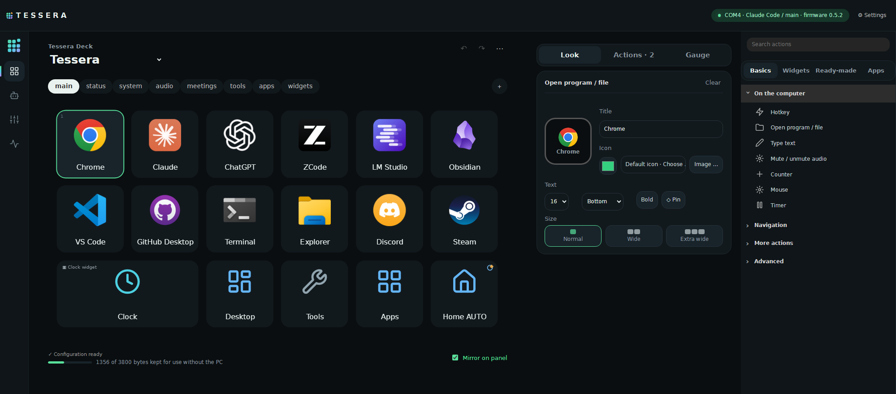
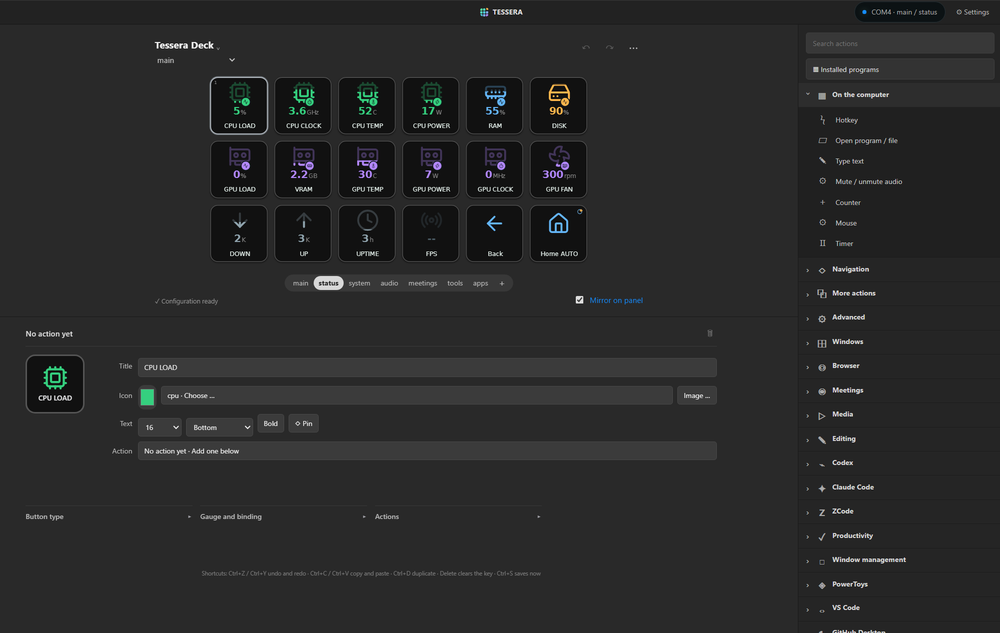

# Features

[Back to the README](../README.md)

Tessera turns the 1024 × 600 touchscreen of the **GUITION 7-inch ESP32-P4 display board** into a DIY Stream Deck-style control surface with 18 keys and
four screens: launch apps, fire hotkeys, drive Codex and Claude Code, mix the sound, watch live system gauges and run multi-step macros.
A small Windows host owns the USB connection, runs the actions and serves a drag-and-drop editor that shows the
same keys as the panel.

  

| Editor — a page of widgets | Editor — status page with live gauges |
|---|---|
|  |  |

| Panel — main page | Panel — widgets on wide keys |
|---|---|
|  |  |

| Panel — agents screen | Panel — mixer screen |
|---|---|
|  |  |

| Panel — status page |  |
|---|---|
|  |  |

*The editor images show the real editor with this PC's sensor values. The panel images are drawn by the real firmware UI (LVGL) in a native build, not photographed: the key pages with `tools/render_screens.py`, the agents and mixer screens by the native UI test with sample data.*

### On the panel

- **Fast, flicker-free panel UI** — a fixed 6 × 3 grid rendered by LVGL. Live values and labels update in place, so a key is not rebuilt under your finger; the grid is only rebuilt when the page or its layout changes.
- **Four screens on a rail** — keys, AI agents, a sound mixer and the PC's status. The agents screen shows what Claude Code, Codex and ZCode are doing and answers Claude Code's permission questions with **Allow** or **Deny**; the mixer has faders for the speakers, up to three programs and the microphone. You choose which screens the rail shows, their order and up to three shortcuts to your own pages.
- **Wide keys and widgets** — a key can cover two or three slots. Ready-made widgets show the clock, the date, the processor, the graphics card, memory, network speed, volume and the AI agents; a wide key can also show the music that plays or a timer's countdown.
- **Real app icons** — rendered by the Windows shell at 256 px (Store apps, shortcuts and aliases included) and scaled to the panel, plus 1,895 bundled [Lucide](https://lucide.dev) icons and your own PNG, JPEG, GIF and WebP images.
- **Live gauges** — CPU, GPU, VRAM, RAM, disk, network, uptime, temperatures, power, fan speed and FPS. The icon fills from the bottom with the value, a small badge says what is measured, and amber and red mark the thresholds.
- **Keys that follow the PC** — the microphone, speaker and media buttons show the real Windows state (muted, live, playing) and flip on their own, and labels can show the current track and volume.
- **Ambient screen and offline layout** — an idle clock built from brand-colored tiles (with optional weather from Open-Meteo for a city you choose); the panel remembers its last layout and shows it even when the PC is off.
- **Auto-dim and brightness** — dim after inactivity or when the PC locks, and wake with a touch that does not trigger a button.

### In the editor

- **A WYSIWYG editor** — the panel's rail on the left, the keys with their page tabs in the middle, the selected key's settings in three tabs (Look, Actions, Gauge) and the action list in four tabs (Basics, Widgets, Ready-made, Apps), with drag and drop, undo/redo, copy/paste, folders, pinned buttons, toggle buttons with 2–8 states and multi-step actions. The editor follows the panel when the profile changes.
- **119 ready-made actions and 10 profile templates** for Windows, windows and desktops, PowerToys, GitHub Desktop, VS Code, browsers, meetings (Teams, Zoom, Discord), media, Codex, Claude Code and ZCode.
- **Your own look** — background, label and outline colors per key, an image cropper, and optional online icon search (Iconify) next to the 1,895 offline icons.
- **Test before you press** — *Test (dry run)* explains what a key would do, checks paths, hotkeys and web addresses, and runs nothing.

### Actions and automation

- **Smart profiles** — the panel switches profile by the foreground program, process or window title, and returns to the profile you had before when that program loses focus. A *Lock profile* key keeps the current profile until you press it again.
- **Long press and double press** — a key can have a second action (`hold_actions`, the *Held* tab in the editor) that runs when you hold it for about half a second, and a third (`double_actions`, the *Double-press* tab) for two quick taps. A key with a double-press waits about a third of a second before its normal action runs.
- **Counters and timers** — `counter` and `timer` actions with labels (`$(counter:laps)`, `$(timer:tea)`), a countdown on the key, notifications and end actions. They are saved, and a running timer keeps counting while Tessera is closed.
- **Scriptable** — a local control API and the `deckctl` command line let hooks and scripts set variables, colors, button states and pages (for example a Claude Code status light).
- **Integrations** — plugins with their own limited API tokens ([`docs/PLUGINS.md`](PLUGINS.md)) and adapters that turn Claude Code hooks and Codex notifications into key states.

### Sensors, safety and upkeep

- **Free sensors** — Windows performance counters out of the box; the graphics driver fills in GPU temperature, power, fan speed and clock without administrator rights (AMD through ADL, NVIDIA through `nvidia-smi`); [Libre Hardware Monitor](https://github.com/LibreHardwareMonitor/LibreHardwareMonitor) adds the CPU temperature and power. `Tessera.cmd --sensors` makes it start at every sign-in (one Windows prompt); `--sensors-off` undoes it.
- **Safe by default** — verified device identity, a bounded action queue, long commands that never block other keys, import review, rotating backups with restore and configuration versioning.
- **Tray app and autostart** — start with Windows and control the host from the tray.
- **Easy upkeep** — panel firmware installer with verified packages and an update check, `Tessera.cmd --setup`, `--uninstall` and `--diagnostics`.
