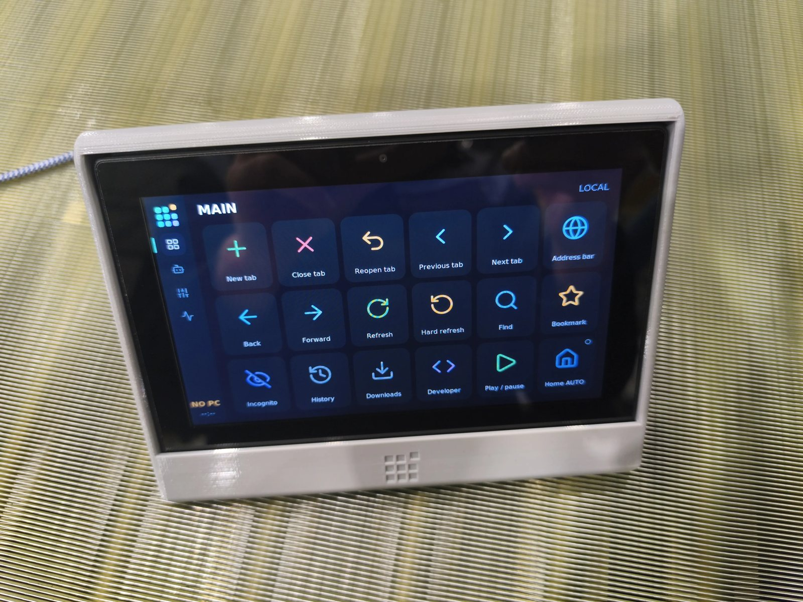
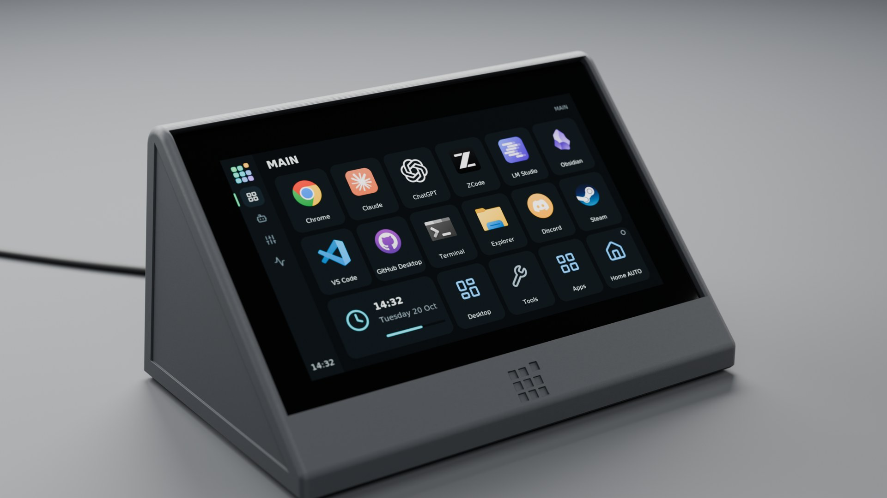
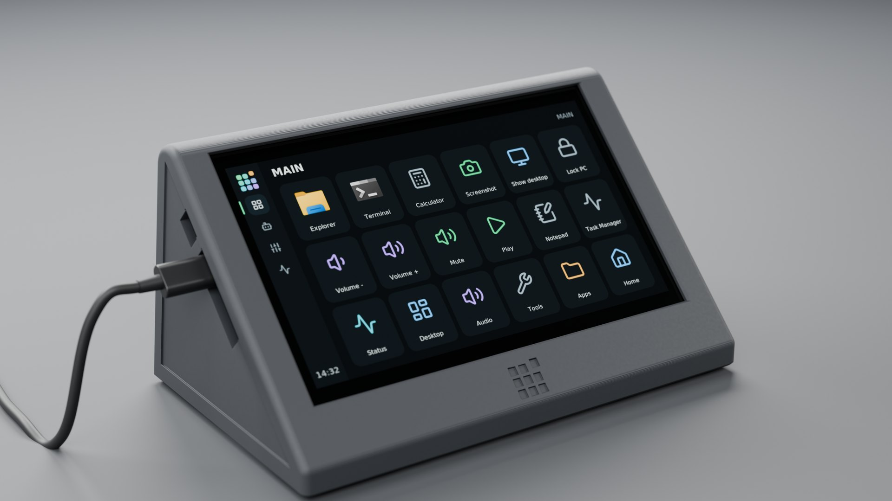

# Desk console and dock

[Back to the README](../README.md)

Printable stands for two panels. Each panel has its own section below, with its own print settings, assembly and sizes.

| Panel | Stand | Files |
|---|---|---|
| [GUITION JC1060P470C](#guition-jc1060p470c), in its factory housing (the `_Y` variant) | Console | `console/` |
| [GUITION JC1060P470C](#guition-jc1060p470c), in its factory housing | Dock | `dock/` |
| [Elecrow CrowPanel Advance 7.0](#crowpanel-advance-70), the bare board without Elecrow's casing | Console | `crowpanel/` |

`scripts/` has the scripts that build the models, and `render/` has the Blender scenes for the pictures.

## Files

| File | What it is |
|---|---|
| `console/tessera-enclosure.stl` | GUITION console, for the slicer |
| `console/tessera-enclosure.step` | GUITION console, for any CAD program |
| `console/tessera-enclosure.FCStd` | GUITION console, FreeCAD model: a Part Design body with sketches, pads, pockets and fillets, a sheet of sizes, and the panel as a reference body |
| `console/tessera-enclosure.png` | The GUITION console with the panel in place in FreeCAD |
| `crowpanel/tessera-enclosure-crowpanel.*` | CrowPanel console, in the same three formats |
| `dock/tessera-dock.stl` | GUITION dock, for the slicer |
| `dock/tessera-dock.blend` | GUITION dock, Blender model |
| `render/tessera-console.blend` | GUITION console with the panel, feet and cable in a studio, Blender model with five cameras |
| `render/tessera-desk.blend` | The same console on an oak desk in front of a monitor, Blender model with three cameras |
| `scripts/make_enclosure.py` | Builds either console and exports the STL and STEP; every size is a parameter at the top |
| `scripts/make_dock.py` | Builds the dock; every size is an option |
| `scripts/save_view.py` | Stores a ready view in the GUITION console's FreeCAD file, so it opens looking at the console |
| `scripts/make_render.py` | Builds `tessera-console.blend` or `tessera-desk.blend` and renders the pictures into `render/renders/` |
| `scripts/render_desk.py` | The desk scene for `make_render.py`: the desk, monitor, keyboard, mouse and the everyday things around them |
| `scripts/export_render_mesh.py` | Writes the GUITION console as a fine mesh with the exact surface normals for `make_render.py` |

## GUITION JC1060P470C

Two stands for the GUITION JC1060P470C in its factory housing (the `_Y` variant):

| | Console | Dock |
|---|---|---|
| Idea | A closed shell: the screen reclines 45° in a chamfered frame, and the cables and the raised box on the back are hidden | An open stand: the panel drops in from the top and leans back 30° against two uprights |
| Panel fixed by | 4 screws, or just its own weight | Its own weight |
| Back | Closed, with air openings, a cable arch and two screwdriver holes | Open, so the ports and cables stay free |
| Drawn with | FreeCAD (`make_enclosure.py`) | Blender (`make_dock.py`) |



The console has been printed, and the GUITION panel fits it perfectly. The other boards have not been tried in it.



The console has a chin with the Tessera tile mark, a short upright apron, a sunken field on each end, a chamfer round the base and four recesses underneath for 10 mm stick-on rubber feet.

### Print settings

| | Console | Dock |
|---|---|---|
| Orientation | Standing, as it stands on the desk (open underside on the bed) | Standing on its base frame, as it stands on the desk |
| Layer height | 0.2 mm | 0.2 mm |
| Supports | None: the front reclines 45° and the back leans 10°. The shelf under the screen stands on a wall from the bed, and the rim over the back opening grows out of the back wall | None expected: it leans back 30° and stands on its floor and ribs; check the slicer's overhang preview |
| Infill | 15 %; the 2.8 mm shell is nearly solid with 3 walls, so infill hardly matters | 20 %; the base frame keeps it from tipping |
| Walls | 3 (1.2 mm with a 0.4 mm nozzle) | 3; the side walls and uprights are 3 to 4 mm thick |
| Hardware | 4 × M2 × 6 mm screws with a washer (thread not confirmed, see below), 4 stick-on rubber feet Ø 10 mm | None |
| Material | PLA or PETG, about 190 g if solid | PLA or PETG |

The console measures 191.0 × 124.4 × 103.8 mm and holds 152 cm³ of plastic. Rubber feet under the two long edges keep it from sliding when you press a key.

### Assemble the console

1. Stand the console on the desk. If you want, plug in the USB cable first through the open bottom.
2. Put the panel's bottom edge behind the low lip at the foot of the pocket. Tilt the panel back until it rests on the rim. It now stays by its own weight, and you can lift it out by its top edge.
3. To fasten it, hold the panel in and lay the console face down on a cloth.
4. Behind each corner post of the panel there is a tab with a 2.6 mm hole. Put a screw through each tab into the brass insert of the post. Reach the two bottom screws from the open underside and the two top screws through the two 8 mm holes in the back. Tighten gently: the screws only pull the panel against the rim.

Screws: 4 pieces, 6 mm long, with a washer. The thread is not stated in the manufacturer's files. The hole in the insert is drawn as 2.00 mm, which points to M2. Try an M2 screw first and do not force an M2.5.

The pocket is 183.0 × 114.9 mm and 11.2 mm deep (0.6 mm clearance all round), so the glass sits 2.6 mm below the front. The lip covers 3.5 mm at the bottom of the glass, and the picture starts 13.5 mm in.

The dock needs no assembly: drop the panel in from the top.

### GUITION sizes

From the manufacturer's structure drawing (`3-Structure_Diagram/JC1060P470C_I_W_Y-模型.pdf` in [wegi1/ESP32P4-JC1060P470C-I_W_Y](https://github.com/wegi1/ESP32P4-JC1060P470C-I_W_Y)):

| | mm |
|---|---|
| Outline | 181.80 × 113.72 |
| Picture (active area) | 155.01 × 86.72 |
| Flat part (slab) thickness | 8.00 |
| Raised box on the back | 124.66 × 74.67, 8.38 deep |
| Depth over all | 20.38 |
| Corner posts | 4 × Ø2.00 holes on 166.00 × 99.00 |

The drawing does not give everything, so the rest comes from the same repository:

| | Value | From |
|---|---|---|
| USB-C sockets | Both face straight back through the cover, about 13 mm in from one side of the box | Specification, pages 5 and 6 |
| Ethernet jack | Stands 4 mm proud of the box (the drawing's 20.38 over all) | Drawing and side photo |
| Corner posts | About 4.6 mm across, 5 mm tall (they end 13 mm behind the glass); brass inserts | Side photo `PICTURES/11.jpg`, measured in the image |
| Box position | Centred within about 1.5 mm | Side photo |
| Panel corner radius | About 3 mm | Front photo, estimated |

The console script draws the panel with these parts, plus a 35 mm long USB plug in each socket position, and stops if anything touches the shell. Values measured from photos are good to about half a millimetre.

Check on your own panel:

- The thread in the posts (the hole is 2.00 mm) is not stated anywhere. The console does not use it.
- Posts thicker than about 7 mm would touch the rim. Make `rim` smaller if yours are.

### Change the console

Open `console/tessera-enclosure.FCStd` in FreeCAD. The body **Enclosure** is built in this order:

| Feature | Sketch | What it does |
|---|---|---|
| Shell | Outline | The side outline (apron, reclining front, back), padded to the full width |
| RoundTop, SoftFront, RoundEnds | | Rounds the top (10 mm), the edge above the apron (4 mm) and the two ends (3 mm) |
| BaseChamfer | | A 1.2 mm chamfer round the base |
| Hollow | Inside | Hollows the shell; the front stays thick for the pocket, and there is no floor |
| HollowChin | ChinInside | Thins the chin and the apron to the wall thickness, to save plastic |
| ChinWeb | ChinWebOutline | A 1.6 mm upright wall under the back edge of the shelf the screen stands on, so the shelf does not start in the air |
| PanelPocket | PanelOutline | The pocket the panel lies in, on the leaning **FrontPlane** |
| FrameChamfer | | A 0.8 mm chamfer round the mouth of the pocket |
| BackOpening | RimOpening | Opens the pocket to the inside, leaving the rim the panel rests on |
| Lip | LipOutline | The low lip that holds the bottom edge |
| TileMark | MarkTiles | The three-by-three tile mark, 0.6 mm deep, in the chin |
| ScrewTabs | TabOutlines | Four tabs behind the corner posts, on **TabPlane** |
| TopBrace | TopBraceOutline | Fills the space between the rim over the back opening and the back, so that rim grows out of the back wall at 45° |
| ScrewHoles | ScrewHoleCentres | A 2.6 mm hole in each tab |
| ScrewAccess | AccessHoleCentres | Two 8 mm holes through the back, in line with the top screws |
| FootPads, FootRecesses | FootPadOutlines, FootCentres | Four pads in the corners, joined to the walls, with a 10.4 mm recess for a rubber foot |
| TrimAtDesk | BelowDesk | Cuts off what reaches below the desk |
| CheekRight, CheekLeft | CheekFieldRight, CheekFieldLeft | A 0.6 mm sunken field on each end |
| CableOpening | CableArch | An arch, 30 mm wide, for the USB cable in the foot of the back |
| AirTiles | VentTiles | Three rows of eleven square openings in the back |

Every sketch is fully constrained with dimensions from the origin: double-click a sketch and change a number. The sheet **Sizes** drives the lengths of the pads and pockets: outer and inner width, pocket depth, lip, tab thickness, and the depths of the tile mark, the end fields and the foot recesses.

Changing the tilt or the panel size moves several sketches at once. For that, edit the `P = dict(...)` block at the top of `make_enclosure.py` and build the model again:

```powershell
& "C:\Program Files\FreeCAD 1.1\bin\freecadcmd.exe" hardware\scripts\make_enclosure.py
```

The script stops with a message if a feature fails, a sketch is not fully constrained, the body is not one valid solid, or the panel or a USB plug would touch the shell.

To open the result looking at the console, run `save_view.py` after it:

```powershell
& "C:\Program Files\FreeCAD 1.1\bin\freecad.exe" hardware\scripts\save_view.py
```

### Change the dock

`make_dock.py` writes `dock/tessera-dock.stl` and `dock/tessera-dock.blend`. Pass any size as an option, for example:

```powershell
blender -b --factory-startup --python-exit-code 1 -P hardware\scripts\make_dock.py -- --tilt 30 --slab 10
```

Run it with `--help` after `--` to list the options.

### Render the console

`make_render.py` builds the GUITION console in Blender as a printed part: matte PLA with 0.2 mm layer lines and softly rounded edges. It adds the panel in its factory housing with black cover glass, and shows a real panel screen in the picture area. It also adds four rubber feet and a USB-C cable that runs from the panel's socket out through the cable arch. The scene is a studio with five cameras: `hero`, `user` (the view from your chair), `side`, `back` and `detail` (the tile mark).

The console mesh comes from the CAD model in `console/`, so make it first. It is not in the repository because the script writes it in a few seconds:

```powershell
& "C:\Program Files\FreeCAD 1.1\bin\freecadcmd.exe" hardware\scripts\export_render_mesh.py
blender -b --factory-startup --python-exit-code 1 -P hardware\scripts\make_render.py -- --res 3840x2160 --samples 512
```

This writes `render/tessera-console.blend` and `render/renders/hero.png` to `render/renders/detail.png`. On a Radeon RX 6950 XT each 4K picture takes about 80 seconds. Add `--scene desk` for the console on a desk (the picture at the top of the main README is `desk_close`). Options after `--`:

| Option | Default | What it does |
|---|---|---|
| `--res` | `3840x2160` | Size of the pictures |
| `--samples` | `512` | Samples per pixel (denoised) |
| `--scene` | `studio` | `desk` puts the console on a used oak desk with a monitor, a keyboard, a mouse, a cup of coffee, headphones and a plant, lit by a window, and saves `tessera-desk.blend` |
| `--shots` | all of the scene's | Cameras to render, for example `hero,user`; the desk scene has `desk`, `desk_wide` and `desk_close` |
| `--screen` | `docs/images/panel-main.png` | The picture on the screen; any 1024 × 600 image, such as a render from `tools/render_screens.py` |
| `--monitor` | `docs/images/editor-widgets.png` | The picture on the monitor in the desk scene; it is cropped to fill 16:9 |
| `--color` | `2d3034` | Colour of the printed shell (sRGB hex) |
| `--no-render` | | Only build and save the `.blend` |

The panel sizes are the manufacturer's: picture 155.01 × 86.72 mm, so a pixel is a little wider than it is tall, as on the real panel. The build was checked to make sure the panel and the cable do not touch the shell.

## CrowPanel Advance 7.0



`crowpanel/tessera-enclosure-crowpanel.stl` (and `.step`, `.FCStd`) is the console for the Elecrow CrowPanel Advance 7.0 (ESP32-P4) without Elecrow's casing: the bare board with the glass on it. It has the same shape as the GUITION console, with a window for the glass instead of a pocket for a housed panel. It measures 189.1 × 116.3 × 96.9 mm standing and holds 133 cm³ of plastic.

The front laps 1 mm over the glass all round and leaves a 162.9 × 98.0 mm window. The board goes in from below, through the open base, and slides straight up into place; the inside is cut away along its path, so the parts on its back clear the shell. Both USB-C sockets and the power switch reach out through windows in the left end.

### Print settings

| | |
|---|---|
| Orientation | Lying on its front, as the STL is laid out |
| Supports | None |
| Layer height, walls, infill | As for the GUITION console: 0.2 mm, 3 walls, 15 % |
| Hardware | 4 × M3 × 8 mm screws, 4 stick-on rubber feet Ø 10 mm |
| Material | PLA or PETG |

### Assemble

1. Hold the console up and push the board in from below, glass forward, with the USB-C sockets on the left, until the glass sits in the window.
2. Put an M3 × 8 screw through each corner hole of the board into the 2.6 mm hole under it. The top two are reached through the round holes in the back, the bottom two from below.
3. Plug the cable into the upper USB-C socket (UART0) through the window in the left end. The small window above it gives a fingertip to the power switch.

### CrowPanel sizes

From Elecrow's STEP model of the board (the `3D file` folder in [Elecrow-RD/CrowPanel-Advanced-7inch-ESP32-P4-HMI-AI-Display-1024x600-IPS-Touch-Screen](https://github.com/Elecrow-RD/CrowPanel-Advanced-7inch-ESP32-P4-HMI-AI-Display-1024x600-IPS-Touch-Screen)):

| | mm |
|---|---|
| Board | 176.90 × 104.00 |
| Corner holes | 4 × M3 on 171.00 × 98.00 |
| Glass | 164.90 × 100.00, centred on the board |
| Glass front to the back of the board | 7.70 |

The parts on the back of the board (connectors, headers, the ESP32-C6, speakers, buttons) come from their bounding boxes in the same model. The script draws them with a 35 mm USB-C plug in either socket, checks that none of it touches the shell, and moves the board 150 mm straight down in steps to check that it comes out without touching.

The opening for the board is 181.1 × 105.2 mm, 1.5 mm wider than the board at each end, so the USB-C sockets clear the end walls. The optional camera does not fit: it stands 11 mm over the top edge of the board.

### Change the CrowPanel console

The sizes are in the `if CROW:` block under `P = dict(...)` in `make_enclosure.py`. Build it with:

```powershell
$env:TESSERA_BOARD = 'crowpanel'; & "C:\Program Files\FreeCAD 1.1\bin\freecadcmd.exe" hardware\scripts\make_enclosure.py; Remove-Item Env:TESSERA_BOARD
```

The FreeCAD model has the same features as the GUITION console without Lip, ScrewTabs and TopBrace, and adds GlassRecess (the room for the glass) and SideWindows (the windows in the left end). The cut along the board's way in is made after the body, so the printed shape is the separate object **Console (printed)**, and the STL and STEP come from it.
